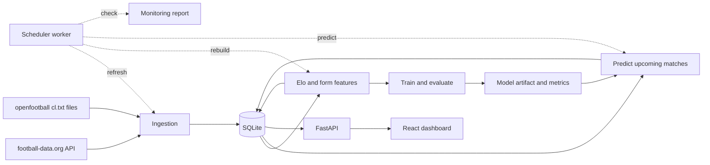

# UCL Predictor

**Match-outcome probabilities for the UEFA Champions League, updated as results come in.**

An end-to-end machine-learning project: it ingests Champions League results, rates every club with Elo, estimates home / draw / away probabilities for upcoming matches, and serves them through a REST API to a React dashboard. A background worker refreshes the data, rebuilds ratings and predictions whenever a result changes, and monitors the model against a base-rate baseline.


<div align="center">
  
</div>


## Features

- **Probabilities for every upcoming match**, shown as a stacked home / draw / away bar.
- **Odds history.** Predictions are stored append-only with a model version, so each match page shows how its odds moved as other results came in.
- **Team ratings.** An Elo leaderboard and a rating-over-time chart for every club, back to the 2011/12 season.
- **Automatic updates.** A scheduler polls every 10 minutes around kickoff and every 6 hours otherwise. Ratings, features and predictions are rebuilt only when a result actually changed.
- **Honest evaluation.** Chronological splits, leakage tests, paired-bootstrap comparisons, and a live monitor that scores the model's real pre-match predictions.

## How it works



**Data.** Results from 2023/24 onward come from the football-data.org free tier. Earlier seasons (2011/12 to 2022/23) are loaded from the public-domain [openfootball](https://github.com/openfootball/europe-champions-league) text files. Club names from the two sources are matched through a normalizer plus a small override file (`ucl/ingestion/team_aliases.csv`).

**Features** (all computed from information available *before* kickoff):

| Feature | Description |
|---|---|
| `elo_diff` | Home rating minus away rating. Updated after every match with a goal-difference multiplier and a home-advantage bonus. Finals are treated as neutral, and ratings shrink 20% toward the mean each new season. |
| `form_pts_diff`, `form_gf_diff`, `form_ga_diff` | Differences in points, goals scored and goals conceded per game over each side's last 5 matches, shrunk toward the league average so thin histories don't produce extremes. |
| `neutral`, `is_knockout` | Whether the match is a final, and whether it is a knockout tie. |

**Model.** Multinomial logistic regression (scikit-learn) on standardized features. Continuous inputs are clipped to the 1st-99th percentile range seen in training, so a rating gap the model has barely seen cannot be extrapolated into extreme odds. The target is the **result after 90 minutes**.

## Results

Chronological split, with the first two seasons dropped as rating warm-up:

| Split | Seasons | Matches |
|---|---|---|
| Train | 2013/14 to 2020/21 | 994 |
| Validation (picks regularization) | 2021/22 to 2022/23 | 250 |
| Test (scored once) | 2023/24 to 2026/27 so far | 557 |

The final model is refit on train plus validation before the test set is scored.

| Model (test set) | Log loss | Brier | Accuracy |
|---|---|---|---|
| Base rates only (always guess the training frequencies) | 1.0165 | 0.6130 | 50.6% |
| Elo only | 0.9310 | 0.5475 | 57.6% |
| **Elo + form (served model, `v2`)** | 0.9325 | 0.5479 | 58.4% |

Reference: a uniform guess scores 1.0986 log loss and 0.6667 Brier.

What the numbers say:

- **Elo adds real signal.** It beats the base-rate model by 0.085 log loss (paired bootstrap 95% CI -0.121 to -0.050).
- **The form features do not measurably help.** Elo + form versus Elo alone is +0.0015 log loss (95% CI -0.0065 to +0.0095), which is indistinguishable from zero. In practice the served model is an Elo model.
- **The model has no real draw signal.** Draw probability only moves because the home and away probabilities move. On the test window it over-predicted draws (about 23% predicted against 17% observed in the 20-30% bin, n = 397).

## Quick start

**Prerequisites:** Python 3.11+, [uv](https://docs.astral.sh/uv/), Node.js 20.19+ (or 22.12+), and a free API token from [football-data.org](https://www.football-data.org/). Docker is optional.

```bash
git clone https://github.com/<your-username>/ucl-predictor.git
cd ucl-predictor
uv sync
```

Create a `.env` file in the project root:

```
FOOTBALL_DATA_TOKEN=your_token_here
DATABASE_URL=sqlite:///data/ucl.db
MODEL_VERSION=v2
```

### 1. Load the data

```bash
# Recent seasons from football-data.org (the free tier covers 2023/24 onward)
uv run python -m ucl.ingestion.historical
```

Then download the `cl.txt` file for each season from 2011-12 to 2022-23 from [openfootball/europe-champions-league](https://github.com/openfootball/europe-champions-league) into this layout:

```
data/external/openfootball/2011-12/cl.txt
data/external/openfootball/2012-13/cl.txt
...
data/external/openfootball/2022-23/cl.txt
```

```bash
uv run python -m ucl.ingestion.openfootball
```

This prints, per season, how many matches it parsed against the count declared in each file's header, and writes `data/processed/team_resolution.csv`. Review the clubs marked `new` and add any that are really existing teams to `ucl/ingestion/team_aliases.csv` (`alias,canonical`), then rerun the loader. It is safe to repeat.

### 2. Build features, train, predict

```bash
uv run python -m ucl.features.build          # Elo ratings and form features
uv run python -m ucl.models.train --version v2
uv run python -m ucl.models.predict          # stores predictions for upcoming matches
```

Training prints validation and test scores, reliability tables, and saves `artifacts/model_v2.joblib` and `artifacts/metrics_v2.json` (git-ignored).

### 3. Run the app

```bash
# terminal 1: API on http://127.0.0.1:8000 (interactive docs at /docs)
uv run uvicorn api.main:app --reload

# terminal 2: dashboard on http://localhost:5173
cd frontend
npm install
npm run dev

# terminal 3 (optional): keep data and predictions fresh
uv run python -m ucl.pipelines.scheduler
```

The Vite dev server proxies `/api/*` to the FastAPI server, so no CORS setup is needed.

## Docker

Three containers: `api` (FastAPI), `worker` (the scheduler, same image), and `web` (the built React app behind nginx, which proxies `/api/` to the API). The database lives in a named volume and the trained model is mounted read-only from `./artifacts`.

Complete the quick-start steps above first, then seed the volume with your database and start everything:

```bash
docker compose build
docker compose create
docker run --rm -v ucl_dbdata:/data -v "$(pwd)/data:/src:ro" alpine sh -c "cp /src/ucl.db* /data/"
docker compose up -d
docker compose logs -f worker
```

On Windows PowerShell, use `${PWD}\data` in place of `$(pwd)/data`. The dashboard is at http://localhost:8080 and the API at http://localhost:8000. Once the containers are running they own the live database, so don't run the local scheduler against `data/ucl.db` at the same time.

## Automatic updates

`ucl.pipelines.scheduler` loops forever:

1. Fetch the current season from football-data.org.
2. Compare a fingerprint of statuses, scores and kickoff times with the one from before the fetch.
3. If anything changed (or on the first cycle after a start), rebuild Elo and features and append new predictions. A prediction row is only written when a match's probabilities actually change, so history stays meaningful and reruns are idempotent.
4. Run the monitoring checks and log any warnings.
5. Sleep for 10 minutes if a match could be in play (30 minutes before kickoff to 4 hours after), otherwise until the next live window opens, at most 6 hours.

A failed fetch is logged and retried on the next cycle. A one-off refresh is available with `uv run python -m ucl.pipelines.refresh [--force]`.

## API

Interactive documentation is served at `/docs`.

| Endpoint | Description |
|---|---|
| `GET /health` | Liveness and database check |
| `GET /model/info` | Active model version and its stored evaluation metrics |
| `GET /matches?status=upcoming\|finished\|all&season=&limit=` | Matches with the latest prediction from the active model |
| `GET /matches/{id}` | One match plus its full prediction history, oldest first |
| `GET /teams?active_only=true` | Clubs ranked by current Elo |
| `GET /teams/{id}` | Rating history, recent results and upcoming fixtures |

## Monitoring

```bash
uv run python -m ucl.monitoring.report
```

| Check | Question |
|---|---|
| Live performance | How do the model's real pre-match predictions score against a base-rate baseline built only from earlier days? |
| Data freshness | Are any matches well past kickoff but not marked finished? |
| Prediction coverage | Does every match in the next 14 days have a prediction from the active model? |
| Input range | What share of upcoming matches fall outside the range the model was trained on? |

Live performance gives no verdict below 30 scored matches, and flags `WARN` only when the model is significantly worse than the baseline. The command exits with code 1 on any `WARN`, so it can drive an alert.

## Project structure

```
api/                      FastAPI app: routers, schemas, shared helpers
ucl/
  config.py               Settings from environment / .env
  db/                     SQLAlchemy models and session setup
  ingestion/              football-data client, openfootball parser, club-name matching
  features/               Elo, form features, feature-table builder
  models/                 splits, clipping, metrics, training, prediction
  monitoring/             live-performance and health checks
  pipelines/              refresh job and scheduler loop
frontend/                 React + TypeScript dashboard (Vite, React Query, Recharts)
tests/                    pytest suite
.github/workflows/ci.yml  CI pipeline
Dockerfile, docker-compose.yml
```

## Testing and CI

```bash
uv run ruff check .
uv run pytest
cd frontend && npm run lint && npm run build
```

GitHub Actions runs the backend (ruff and pytest), the frontend (ESLint and a type-checked build), and a Docker build of both images on every push and pull request. The tests use in-memory databases and synthetic data, so they need no `.env`, token or trained model.

## Design decisions

- **No leakage, and tests that prove it.** Features are built by walking matches in date order and recording each team's state *before* applying the result. Tests rewrite a match and everything after it and assert that every earlier feature row is unchanged.
- **Time-based evaluation only.** No random splits. Hyperparameters are chosen on a validation window, and the test window is scored once.
- **Judged on probabilities, not accuracy.** Log loss and Brier score, with paired bootstrap intervals, so a small difference isn't mistaken for an improvement.
- **The target is the 90-minute result.** Matches decided in extra time or on penalties are stored with their regular-time score plus a `duration` column.
- **Append-only, versioned predictions.** Every row carries its model version, which enables odds-history charts and fair live evaluation.
- **Model versions are labels, not overwrites.** `v1` (unclipped) and `v2` (clipped) coexist in the database, and `MODEL_VERSION` selects which one the API serves.

## Limitations

- **Champions League results only.** Each club plays 8-13 matches a season in this data, so ratings move slowly and clubs from smaller leagues are hard to place. Domestic results would be the most valuable addition.
- **Weak on draws and on the extremes.** Clipping limits overconfidence on lopsided fixtures but does not remove it.
- **No squad information.** Injuries, line-ups, transfers and xG are not used.
- **Scores in extra-time ties** rely on football-data providing a regular-time score. The ingestion code warns when it is missing.
- **Historical kickoff times** from openfootball are listed wall-clock times rather than true UTC. Only the date is used.
- **Matches in play** are not shown in the upcoming list until they finish.

## Roadmap

- Add domestic league results to the Elo ratings.
- Walk-forward evaluation across all seasons, with recency weighting and draw calibration.
- Goal-based model for scorelines and over/under markets.
- Automated retraining with a model registry, promoting a new model only if it beats the current one.
- Tournament simulation for each club's chance of reaching every round.
- A model-performance page on the dashboard, and alert delivery for monitor warnings.

## Data sources and attribution

- Results from 2023/24 onward: [football-data.org](https://www.football-data.org/) free tier. Check their terms before redistributing the data or using it commercially. No data is committed to this repository.
- Results from 2011/12 to 2022/23: [openfootball](https://github.com/openfootball/europe-champions-league), dedicated to the public domain.

## LICENSE

[MIT](LICENSE) as always

# This Shit Developed By MOHSEN
